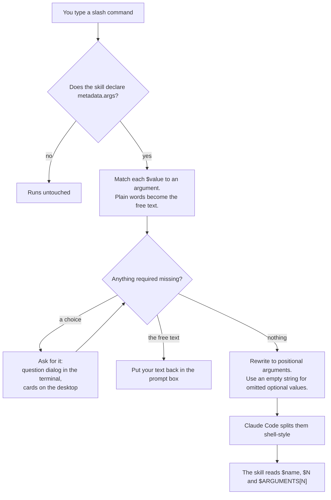

# claude-skill-args

A Claude Code mod that lets any skill you write offer a fixed set of choices as `$value` arguments. Users get autocomplete and clickable cards, and the skill gets clean, predictable arguments.

```
/demo $friendly the weather
```

## The idea

A skill normally gets one blob of free text and has to guess what the user meant:

```
/review take a detailed look at the onboarding redesign
```

With skill-args, you declare the choices once in your skill's frontmatter. Users pick them with `$value`, and your skill reads each one as its own argument:

```
/review $thorough the onboarding redesign
```

| | Without skill-args | With skill-args |
|---|---|---|
| User | Has to remember what the skill understands | Picks from autocomplete or cards |
| Missing input | The skill guesses or asks halfway through | Asked before the skill starts |
| Choices | Free-form and easy to misspell | Picked from a declared list |
| Skill body | Parses `$ARGUMENTS` itself | Reads `$depth` and `$target` |

> [!TIP]
> Your skill body doesn't change. skill-args only rewrites what the user typed into the standard positional arguments that Claude Code already supports, so `$name`, `$0` and `$ARGUMENTS[0]` work as usual.

## Install

```
/plugin install skill-args --marketplace lfb0801/claude-skill-args
```

Answer `y` to add the marketplace, then choose a scope.

> [!NOTE]
> Run this in a terminal session. The desktop Code tab does not offer `/plugin`, but a user-scope install also loads there.

## Try the demo

[examples/demo/SKILL.md](examples/demo/SKILL.md) declares one choice (`tone`) and one free-text argument (`topic`), and echoes what it receives. It isn't installed as a command. To try it, copy it into your skills:

```bash
mkdir -p ~/.claude/skills/demo && cp examples/demo/SKILL.md ~/.claude/skills/demo/
```

Then type `/demo $friendly the weather`. Claude replies with:

```
tone=friendly topic=the weather
friendly | the weather
friendly "the weather"
```

Type `/demo the weather` without a tone and you are asked which tone you want before the skill runs.

## Use it in your own skill

Set `disable-model-invocation: true`, declare choices under `metadata.args`, and use `arguments` to set their positional order. Each example below is a separate skill.

> [!IMPORTANT]
> skill-args runs when *you* type a slash command. It never sees a skill that Claude invokes on its own, so the skill must set `disable-model-invocation: true`.

### 1. Required choices: choose the review depth

Use a required choice when the skill needs a decision before it can start.

```yaml
---
name: review
description: Review a piece of work
disable-model-invocation: true
arguments: [depth, target]
metadata:
  args:
    depth:
      question: How detailed should the review be?
      options:
        brief: 🌱 Quick overview of key points
        thorough: 🔎 Detailed review of each aspect
    target:
      question: What should be reviewed?
---

Review $target. Depth: $depth.
```

Type `/review $thorough the redesign` to pass `thorough` as `$depth` and `the redesign` as `$target`. Both choices are suggested while typing. For example, terminal autocomplete filters by prefix:

```
> /review $t
  $thorough    Detailed review of each aspect
```

Submit `/review the redesign` without a depth and the skill waits for your choice. The terminal asks through Claude's question dialog:

```
 ☐ depth

 How detailed should the review be?

 ❯ 1. brief — Quick overview of key points
   2. thorough — Detailed review of each aspect
   3. Type something.

 Enter to select · Esc to cancel
```

The desktop shows cards in the banner above the prompt:

```
 /review · How detailed should the review be?                    Cancel
 ╭────────────────────────────────╮  ╭────────────────────────────────╮
 │ 🌱 brief                       │  │ 🔎 thorough                    │
 │ Quick overview of key points   │  │ Detailed review of each aspect │
 ╰────────────────────────────────╯  ╰────────────────────────────────╯
```

An invalid answer is asked again. In the terminal, Esc cancels and puts your text back in the prompt.

### 2. Optional choices: add a focus when useful

Use `optional: true` for a choice the skill can work without. Here, a document check can cover the whole document or focus on one area.

```yaml
---
name: check
description: Check a document
disable-model-invocation: true
arguments: [focus, document]
metadata:
  args:
    focus:
      optional: true
      options:
        scope: 🎯 Review what is in and what is out
        risks: 🚨 Identify potential issues
    document:
      question: Which document should be checked?
---

Check $document. Focus on $focus if supplied; otherwise check the whole document.
```

| Typed | `$focus` / `$0` | `$document` / `$1` |
|---|---|---|
| `/check $scope the proposal` | `scope` | `the proposal` |
| `/check the proposal` | *(empty)* | `the proposal` |

The declared choices can appear in autocomplete and typing cards. On submit, a missing optional choice never triggers a question or a required-choice banner. `/check the proposal` runs immediately, with an empty string in the first position: `$ARGUMENTS` is `"" "the proposal"`.

### 3. Open choices: accept a custom audience

Use `open: true` when common choices help, but users should also be able to name their own value.

```yaml
---
name: explain
description: Explain a topic for an audience
disable-model-invocation: true
arguments: [audience, topic]
metadata:
  args:
    audience:
      open: true
      question: Who is the explanation for?
      options:
        beginner: 🌱 Start with the basics
        developer: 💻 Include technical details
    topic:
      question: What should be explained?
---

Explain $topic for $audience.
```

| Typed | `$audience` / `$0` | `$topic` / `$1` |
|---|---|---|
| `/explain $beginner caching` | `beginner` | `caching` |
| `/explain $designer caching` | `designer` | `caching` |

`beginner` and `developer` are suggested choices. The custom `$designer` value is accepted directly; it does not need to be declared. Type custom values in the command as `$value`: the question dialog and cards offer the declared choices.

`open: true` does not make an argument optional. Submit `/explain caching` and you are still asked for an audience before the skill runs. Combine `open: true` with `optional: true` only when a custom value may also be omitted.

### Argument reference

| Key under `metadata.args.<name>` | Meaning |
|---|---|
| `options` | The declared values, each with a description. A leading emoji is shown on desktop cards. |
| `question` | What to ask when a required value is missing. For choices, defaults to `Which <name>?`. |
| `optional: true` | Don't ask for it on submit. A missing value reaches the skill as an empty string. Declared choices can still be suggested while typing. |
| `open: true` | Also accept `$values` that aren't in the declared list. |
| *(no `options`)* | The free-text argument: every plain word the user typed. At most one. |

Rules:

- `arguments:` sets the positional order and enables `$name`. Leave it out and the order of `metadata.args` is used; then use `$0`, `$1`, and so on.
- Every argument is required unless it sets `optional: true`.
- The skill command and `$values` can be written anywhere in the prompt, in any order. For example, `Please /review the redesign` shows the argument cards and asks for the missing required depth before running. Every plain word, including words before the command, belongs to the free-text argument.
- An unknown `$value` fills the first empty open argument. If there is none, it counts as an invalid value for the first empty required strict argument, which is then asked again. Otherwise it stays in the free text.
- Prefer single-codepoint emoji in descriptions.
- Skills without `metadata.args` behave exactly as before.

> [!NOTE]
> `$ARGUMENTS` is the whole rewritten string, not what the user typed. For example, `/review $thorough the redesign` becomes `thorough "the redesign"`. Use `$name` or `$N` for single values. Quoted text in the input is preserved as part of the free-text argument.

## How it works



1. **While you type**, it reads the skill's `metadata.args` and suggests declared `$values` for arguments that have not been filled.
2. **When you submit**, it intercepts the command, matches every `$value`, and asks for anything required that's missing.
3. **Before the skill runs**, it rewrites your input to one quoted value per declared argument, with `""` for an empty optional one, so every position stays in place.
4. **Claude Code** then fills `$name`, `$N` and `$ARGUMENTS[N]` from that string, as it does for any skill.

Commands at the beginning use Claude Code's normal command hook. A skill mentioned later in the prompt is checked before submission and dispatched as a command after all required arguments are supplied; the unchecked prompt is not sent to Claude.

| | Terminal | Desktop app (Code tab) |
|---|---|---|
| Suggestions while typing | Native autocomplete rows for `$values`, after the command and after each completed value. A compact clickable list appears above the prompt when the native menu has nothing to show. | No native autocomplete exists there. A band of clickable cards follows what you type, including Tab completion. |
| Missing required choice on submit | Asked through Claude's own question dialog. | Picked from cards in the banner above the prompt. |
| Missing optional choice on submit | Runs without asking for it. | Runs without asking for it. |
| Missing required free text on submit | Your text is put back in the prompt box. | Your text is put back in the prompt box. |

## Where skill files are found

- Namespaced `plugin:name`: through the plugin's own root, or its `installPath` in `~/.claude/plugins/installed_plugins.json`.
- Plain names: through Claude's command list, then `.claude/skills/<name>/SKILL.md`, then `~/.claude/skills/<name>/SKILL.md`.

If the hook fails before it has read a skill's definition, the command runs untouched. If it fails after that, it refuses to run the command.

## Requirements

- Verified on Claude Code 2.1.293.

> [!WARNING]
> Function hooks (`modules` in `hooks/hooks.json`) are early access and may change. Older CLIs ignore the module, or reject `hooks.json` outright.

## Limitations

- The desktop app never calls the autocomplete hook, so the desktop uses cards instead.
- A band cannot take keyboard focus without ctrl+x tab, so keyboard selection goes through native autocomplete or the question dialog.
- Plugin skills are located through `~/.claude/plugins/installed_plugins.json`, an internal file whose format may change.
- On the desktop the prompt is read once every 500ms, which is how Tab completion is noticed.

> [!CAUTION]
> Install only one copy of this feature. A plugin that bundles its own copy, installed alongside this mod, would handle the same skill twice.

## Development

```
claude --plugin-dir .
claude plugin validate .
claude plugin test .
tsc -p .
```

`tsc` needs `.claude-plugin/types/`, which Claude Code generates when it loads the mod. It is gitignored.
